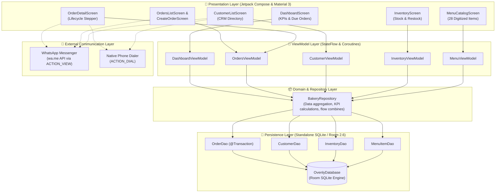
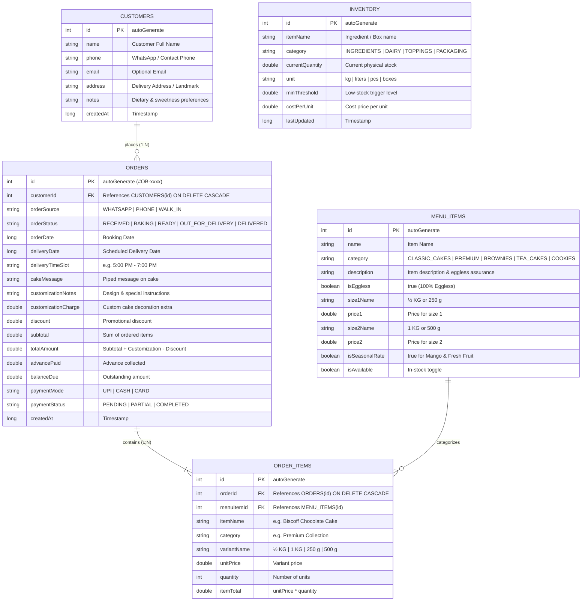
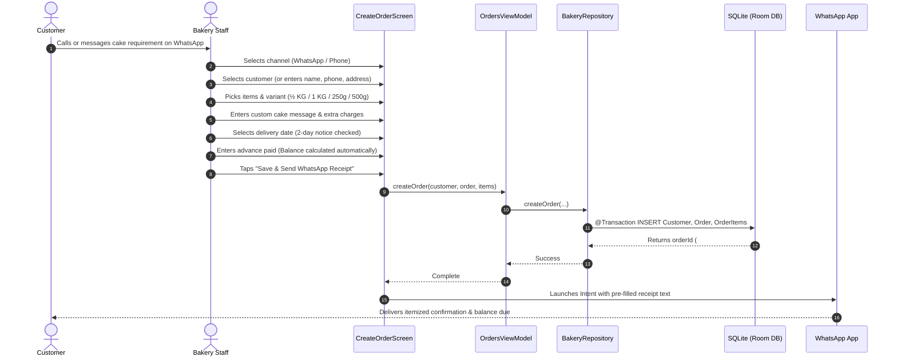

# Ovenly Bites - Standalone Android POS & Order Tracking App 🧁🎂

> **"Freshly Baked With Love ❤️ • 100% Eggless"**  
> A standalone, modern Android bakery management app built with **Kotlin**, **Jetpack Compose (Material 3)**, and **SQLite (Room Database)**.

---

## 📸 Menu Analysis & Digitization

The app comes pre-populated with the exact menu extracted from the official **Ovenly Bites** catalog:

| Category | Item Name | Variant 1 | Price 1 (₹) | Variant 2 | Price 2 (₹) |
| :--- | :--- | :--- | :--- | :--- | :--- |
| **Classic Cakes** | Vanilla Cake | ½ KG | ₹550 | 1 KG | ₹950 |
| **Classic Cakes** | Pineapple Cake | ½ KG | ₹600 | 1 KG | ₹1,050 |
| **Classic Cakes** | Black Forest Cake | ½ KG | ₹600 | 1 KG | ₹1,050 |
| **Classic Cakes** | Butterscotch Cake | ½ KG | ₹600 | 1 KG | ₹1,100 |
| **Classic Cakes** | Strawberry Cake | ½ KG | ₹600 | 1 KG | ₹1,050 |
| **Classic Cakes** | Red Velvet Cake | ½ KG | ₹700 | 1 KG | ₹1,250 |
| **Classic Cakes** | Blueberry Cake | ½ KG | ₹650 | 1 KG | ₹1,200 |
| **Classic Cakes** | Mango Cake (Seasonal) | ½ KG | *Market Rate* | 1 KG | *Market Rate* |
| **Classic Cakes** | Fresh Fruit Cake | ½ KG | *Market Rate* | 1 KG | *Market Rate* |
| **Premium Collection** | Rasmalai Cake | ½ KG | ₹800 | 1 KG | ₹1,500 |
| **Premium Collection** | Chocolate Truffle Cake | ½ KG | ₹750 | 1 KG | ₹1,400 |
| **Premium Collection** | Biscoff Chocolate Cake | ½ KG | ₹800 | 1 KG | ₹1,500 |
| **Premium Collection** | Nutella Cake | ½ KG | ₹800 | 1 KG | ₹1,500 |
| **Premium Collection** | Chocolate Truffle with Whipped Caramel | ½ KG | ₹750 | 1 KG | ₹1,400 |
| **Premium Collection** | Tiramisu Cake | ½ KG | ₹750 | 1 KG | ₹1,400 |
| **Brownies** | Classic Fudgy Brownie | 250 g | ₹270 | 500 g | ₹500 |
| **Brownies** | Nutella Brownie | 250 g | ₹350 | 500 g | ₹600 |
| **Brownies** | Whole Wheat Walnut Brownie | 250 g | ₹350 | 500 g | ₹600 |
| **Brownies** | Mocha Brownie | 250 g | ₹280 | 500 g | ₹500 |
| **Tea Cakes** | Kesar Badam Tea Cake | 250 g | ₹300 | 500 g | ₹550 |
| **Tea Cakes** | Honey Oats Tea Cake | 250 g | ₹300 | 500 g | ₹550 |
| **Tea Cakes** | Pan Bahar Tea Cake | 250 g | ₹250 | 500 g | ₹450 |
| **Tea Cakes** | Marble Tea Cake | 250 g | ₹250 | 500 g | ₹400 |
| **Tea Cakes** | Whole Wheat Chocolate Walnut Tea Cake | 250 g | ₹250 | 500 g | ₹450 |
| **Cookies** | Oats & Almond Cookies | 250 g | ₹350 | 500 g | ₹650 |
| **Cookies** | Multigrain Cookies | 250 g | ₹300 | 500 g | ₹550 |
| **Cookies** | Choco Chip Cookies | 250 g | ₹300 | 500 g | ₹550 |
| **Cookies** | Karachi Biscuits | 250 g | ₹200 | 500 g | ₹350 |

### Bakery Rules Enforced:
1. **100% Eggless Assurance**: Highlighted on all screens and WhatsApp receipts.
2. **Order 2 Days Before**: Automated alert banner when scheduling deliveries within 48 hours.
3. **Cake Customization Charge**: Dedicated extra fee and note capture for cake messages and bespoke decorations.

---

## 🚀 Key Features

### 1. WhatsApp & Phone Call Order Tracking
- **Channel Indicators**: Distinct color badges (🟢 **WhatsApp**, 🔵 **Phone Call**, 🟣 **Walk-in**).
- **One-Tap WhatsApp Receipt Generator**: Formats order summary with item list, weights, message on cake, advance paid, and balance due, and launches WhatsApp directly.
- **Automated Customer Updates**:
  - *Order Confirmation & Invoice*
  - *Baking in Progress Notice* ("Your cake is in the oven baking with love!")
  - *Ready for Pickup / Out for Delivery Alert*
- **One-Tap Native Phone Dialer**: Instant call to customer from order card or customer directory.

### 2. Standalone Offline SQLite Database (Room 2.6)
- **Zero Cloud Dependence**: 100% standalone, works offline.
- Pre-populated on first install with full menu, starter inventory, and sample orders.
- Full ACID transactions for order items and financial tracking.

### 3. Customer Management (CRM)
- Customer profiles with name, phone number, delivery address, and dietary notes.
- Quick search by name or phone number.
- Order history tracking per customer.

### 4. Bakery Inventory & Low Stock Alerts
- Track raw ingredients (Belgian Chocolate, Biscoff, Nutella, Butter, Flour, Cocoa).
- Track packaging supplies (½ KG boxes, 1 KG boxes, ribbons, tins).
- Real-time **Low Stock Alert** on the Dashboard when stock drops below threshold.
- Quick **Restock (+)** and **Consumed (-)** adjustments.

### 5. Order Workflow Lifecycle
- `Received` ➔ `Baking & Preparing` ➔ `Ready for Pickup` ➔ `Delivered`.
- Financial balance tracking (Total, Advance Paid, Balance Due, Payment Mode: UPI/Cash/Card).

---

## 🛠️ Tech Stack & System Architecture

### 1. High-Level Architecture Diagram (MVVM + Offline-First SQLite)

The application follows Google's recommended modern Android architecture guidelines using **Unidirectional Data Flow (UDF)**, clean separation of concerns, and 100% offline persistence.



---

### 2. SQLite Database Schema & Entity Relationships

The on-device SQLite database manages relational entities with cascading foreign keys:



---

### 3. Order Lifecycle & Status Workflow

```mermaid
stateDiagram-v2
    [*] --> RECEIVED : Customer calls or messages via WhatsApp
    RECEIVED --> BAKING : Baker taps "Mark Baking"
    note right of BAKING : Optional: Send "Your Cake is Baking" WhatsApp update
    BAKING --> READY : Cake baked, cooled & decorated
    note right of READY : Optional: Send "Order Ready for Pickup" WhatsApp alert
    READY --> OUT_FOR_DELIVERY : Handed to delivery driver
    READY --> DELIVERED : Picked up in store
    OUT_FOR_DELIVERY --> DELIVERED : Delivery completed & balance collected
    DELIVERED --> [*]

    RECEIVED --> CANCELLED : Customer cancelled
    BAKING --> CANCELLED : Cancelled before dispatch
    CANCELLED --> [*]
```

---

### 4. End-to-End Order Creation & WhatsApp Confirmation Flow



---

### 5. Architectural Patterns Applied

| Pattern / Component | Implementation Detail | Benefit |
| :--- | :--- | :--- |
| **Clean MVVM** | UI observers `StateFlow` emitted by ViewModels; ViewModels hold no UI references. | Complete testability and separation of concerns. |
| **Reactive Repository** | `BakeryRepository` combines Room DAOs using Kotlin `Flow.combine`. | Real-time UI updates whenever orders or inventory change. |
| **ACID Transactions** | Room `@Transaction` for atomic order insertion and line-item creation. | Zero risk of orphaned items or partial order records. |
| **Offline-First** | SQLite database pre-seeded on first run (`RoomDatabase.Callback`). | Fully operational without internet connectivity. |
| **Material 3 Theming** | Artisan color tokens: Cocoa `#4A2518`, Rose Coral `#B85D43`, Cream `#FFFBF5`. | Distinctive, branded bakery aesthetic. |

---

## 📂 Project Structure

```
OvenlyBytes/
├── app/
│   ├── build.gradle.kts
│   └── src/main/
│       ├── AndroidManifest.xml
│       └── java/com/ovenlybytes/app/
│           ├── MainActivity.kt               # Navigation & app entry
│           ├── OvenlyBytesApp.kt             # Application class & DB holder
│           ├── data/
│           │   ├── local/
│           │   │   ├── OvenlyDatabase.kt     # Room SQLite DB & Menu Seeder
│           │   │   ├── dao/                  # DAOs (Order, Customer, Menu, Inventory)
│           │   │   └── entities/             # Room Entities
│           │   └── repository/
│           │       └── BakeryRepository.kt   # Clean reactive data access
│           ├── model/                        # Enums, Relations & DashboardStats
│           ├── ui/
│           │   ├── components/               # Common bakery UI widgets & badges
│           │   ├── navigation/               # Routes & Bottom navigation
│           │   ├── screens/
│           │   │   ├── dashboard/            # Home KPIs & urgent deliveries
│           │   │   ├── orders/               # Order list, Create Order, Detail
│           │   │   ├── customers/            # Customer CRM
│           │   │   ├── inventory/            # Ingredient & box stock tracking
│           │   │   └── menu/                 # Digital Ovenly Bites menu
│           │   └── theme/                    # Warm Cocoa & Cream bakery theme
│           └── util/                         # WhatsApp & Phone helpers, formatters
```

---

## 📱 How to Run in Android Studio

1. Open **Android Studio** (Ladybug / Koala / Hedgehog or newer).
2. Click **Open** and select `/home/vipul/Documents/Code/OvenlyBytes`.
3. Android Studio will automatically recognize the Gradle build, download dependencies, and index the project.
4. Select an Android Emulator or connected physical device (Android 7.0 / API 24+).
5. Click the green **Run (▶)** button!

