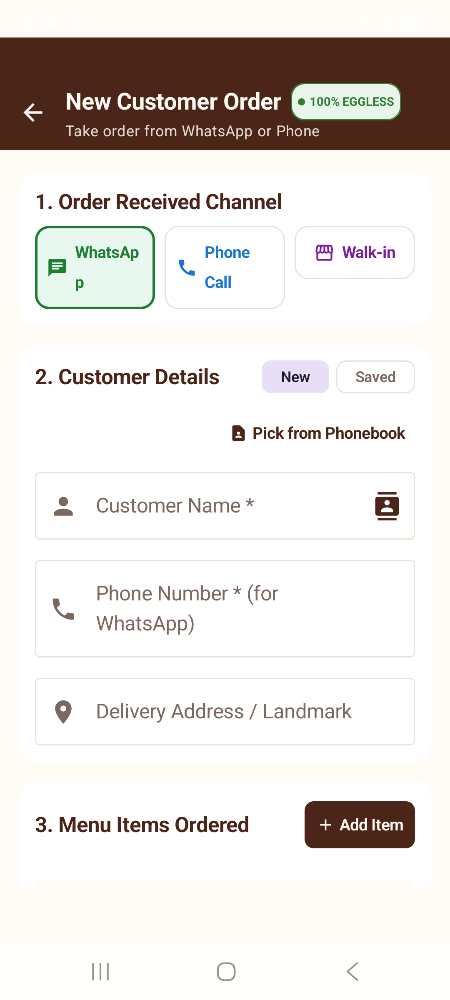
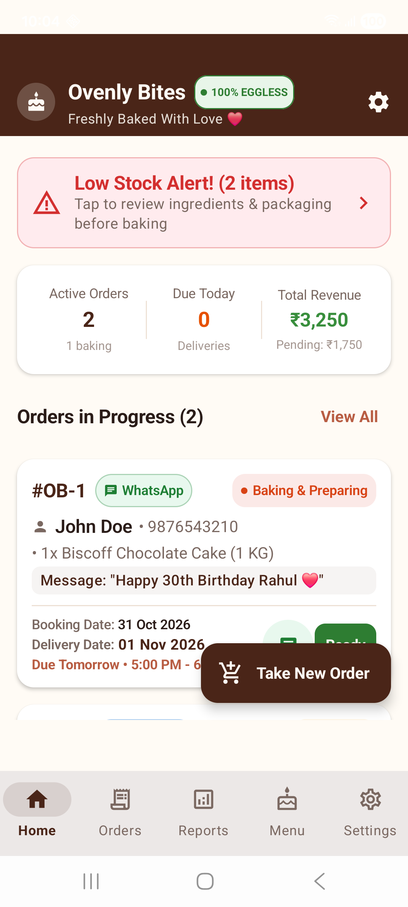
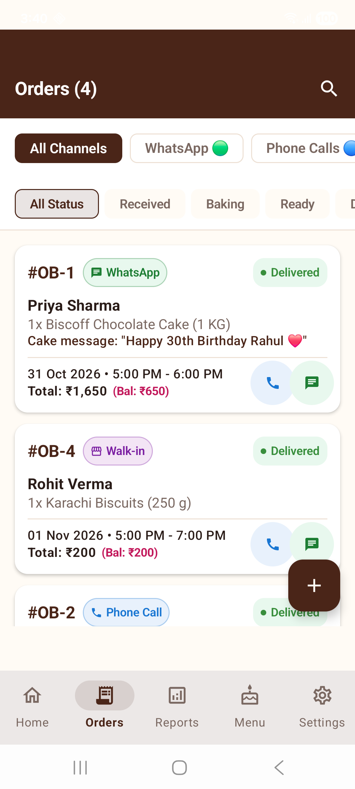
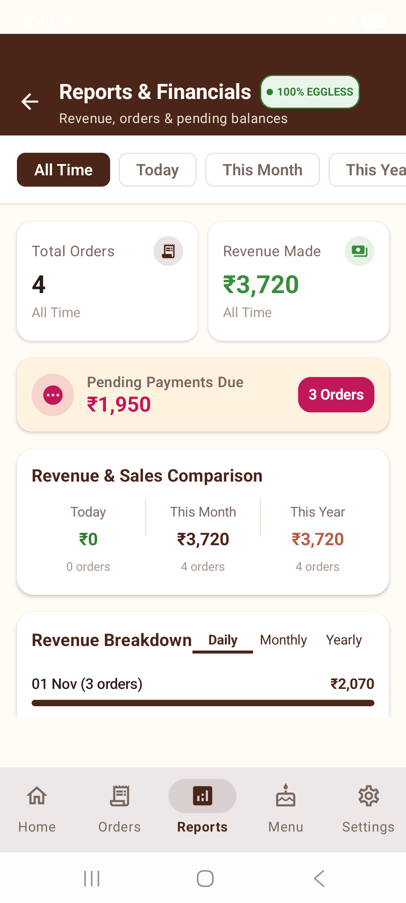
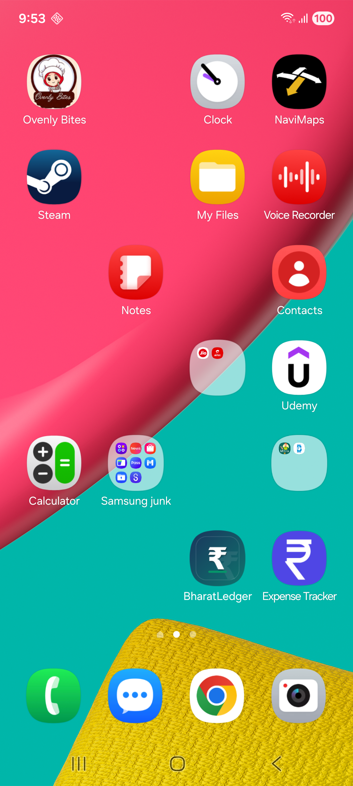

# Ovenly Bytes - Comprehensive User Manual & Operations Guide 📖🧁

Welcome to **Ovenly Bytes**, your all-in-one, offline-first, hardware-encrypted Android Bakery POS and Order Tracking App! This manual provides step-by-step instructions for managing your bakery, taking orders, tracking stock, customizing branding, backing up data in SQL/CSV/JSON formats, and selecting color themes.

---

## 📋 Table of Contents
1. [Overview & Quick Start](#1-overview--quick-start)
2. [Hardware Encryption & Data Security](#2-hardware-encryption--data-security)
3. [Dashboard POS & Daily Operations](#3-dashboard-pos--daily-operations)
4. [Taking Orders & Delivery Notice Policy](#4-taking-orders--delivery-notice-policy)
5. [Order Status Lifecycle & WhatsApp Receipts](#5-order-status-lifecycle--whatsapp-receipts)
6. [Order Sorting & Filtering](#6-order-sorting--filtering)
7. [Financial Reports & Category Revenue Analytics](#7-financial-reports--category-revenue-analytics)
8. [Menu Catalog & Custom Portion Sizes](#8-menu-catalog--custom-portion-sizes)
9. [Inventory Stock & Low Stock Alerts](#9-inventory-stock--low-stock-alerts)
10. [Customer Directory & CRM](#10-customer-directory--crm)
11. [Shop Profile & Branding Settings](#11-shop-profile--branding-settings)
12. [Database Backup & Intelligent Restore (SQL / CSV / JSON)](#12-database-backup--intelligent-restore-sql--csv--json)
13. [12 Bakery Color Themes](#13-12-bakery-color-themes)

---

## 1. Overview & Quick Start

Ovenly Bytes is built for home bakers, artisan cake studios, and commercial bakeries to streamline order management without cloud subscription fees or internet dependency.

### Key Capabilities:
- **100% Offline Local Database**: All data is stored locally on your device using SQLite & Room.
- **SQLCipher 256-Bit AES Encryption**: Entire database is encrypted at rest using Android Keystore Master Keys (`MasterKey`).
- **WhatsApp Integration**: Generate and send formatted receipts, invoice confirmations, baking updates, and pickup alerts in one tap.
- **Multi-Format Backup**: Export and import data anytime in **SQL (.sql)**, **CSV (.csv)**, or **JSON (.json)** format with intelligent auto-format detection.
- **12 Bakery Color Themes**: Choose from 12 bakery color palettes with 3-color swatch previews.

---

## 2. Hardware Encryption & Data Security

Ovenly Bytes incorporates enterprise-grade encryption to protect customer contact numbers, order finances, and bakery records:

- **SQLCipher 256-Bit AES Database**: The local SQLite database file (`ovenly_bites_database.db`) is encrypted on disk.
- **Android Keystore Hardware Key**: Cryptographic keys are generated inside the phone's Secure Element/TEE hardware.
- **EncryptedSharedPreferences**: Shop settings and contact numbers are encrypted at rest.
- **Android 15/16 16 KB Page Boundary Alignment**: Fully compatible with 64-bit Android 15/16 devices.

---

## 3. Dashboard POS & Daily Operations

When you launch Ovenly Bytes, the **Home Dashboard** displays your key operational indicators (KPIs):

- **Active Orders Summary**: Shows pending, baking, ready for pickup, and delivered order counts.
- **Financial Metrics**: Real-time total revenue and total balance pending collection.
- **Orders Due Today Alert**: Displays orders scheduled for delivery today.
- **Explicit Booking & Delivery Dates**: Displays both **Booking Date** and **Delivery Date** clearly on every active order card.
- **Low Stock Banner**: Displays an urgent alert if raw ingredients or cake boxes drop below safety thresholds.

---

## 4. Taking Orders & Delivery Notice Policy

To create a new order, tap the **"Take New Order"** button on the Dashboard or Orders list:

### Step 1: Order Channel & Delivery Schedule Policy
1. Select the order channel: **WhatsApp (🟢)**, **Phone Call (🔵)**, or **Walk-in (🟣)**.
2. **Delivery Notice Policy**:
   - **Standard Policy (Default)**: Requires at least 1-day advance notice (default delivery date is set to Tomorrow).
   - **⚡ Allow Same-Day Express Delivery Toggle**: Turn ON the `⚡ Allow Same-Day Express Delivery` switch to enable today's date for urgent express orders.

### Step 2: Customer Selection or Registration
1. Search and select an existing customer from your directory, or enter details for a new customer (Name, WhatsApp Phone Number, Delivery Address, Dietary Notes).

### Step 3: Item Selection & Customizations
1. Browse menu categories or search items.
2. Select portion weight/variant (e.g., ½ KG, 1 KG, 1.5 KG, 2 KG, 250 g, 500 g, or custom sizes) and quantity.
3. Tap **"+ Custom Item"** to add ad-hoc items on the fly.
4. Enter piped message on cake (e.g. *"Happy Birthday Alex ❤️"*).
5. Add customization decoration notes and extra charges if applicable.

### Step 4: Advance Payment & Balance Calculation
1. Enter advance amount paid and select payment mode (UPI, Cash, Card). The app automatically calculates the balance due.
2. Tap **"Save & Send WhatsApp Receipt"**. The order is recorded in SQLite and WhatsApp launches with a pre-formatted itemized invoice!

---

## 5. Order Status Lifecycle & WhatsApp Receipts

Each order progresses through 5 clear stages:
1. **Received**: Initial booking confirmed.
2. **Baking & Preparing**: Cake is in the oven. Tap *"Send 'Cake is Baking' Update"* to notify the customer on WhatsApp.
3. **Ready for Pickup**: Cake is decorated and ready. Tap *"Send 'Order Ready' Alert"* to notify the customer.
4. **Delivered**: Order handed over and final balance collected.
5. **Cancelled**: Order cancelled.

> **🎉 Bonus Action**: When an order's payment status is updated to **COMPLETED**, a new action button appears allowing you to instantly send a **"Payment Received - Thank You!"** appreciation alert to your customer via WhatsApp!

---

## 6. Order Sorting & Filtering

In the **Orders** tab, customize how your orders are sorted:

- **Sort Options**:
  - 📅 **Delivery Date** (Default - earliest upcoming deliveries first)
  - 🔢 **Order ID** (Latest order numbers first)
  - 💰 **Total Amount** (Highest value orders first)
  - ⏳ **Balance Due** (Highest unpaid balances first)
- **Status Filter Chips**: Quick filter by *All*, *Received*, *Baking*, *Ready*, *Delivered*, or *Cancelled*.

---

## 7. Financial Reports & Category Revenue Analytics

Go to the **Reports** tab to review your bakery financials:

- **Primary KPIs**: Total Orders, Total Revenue, Total Pending Balance.
- **Advanced Metrics**: **Average Order Value (AOV)** & **Payment Collection Rate (%)**.
- **Sales by Bakery Category**: Revenue breakdown with visual progress bars across product categories (*Classic Cakes, Premium Collection, Brownies, Cookies, etc.*).
- **Period Comparison**: Side-by-side revenue and order volume comparison for Today, This Month, and This Year.
- **Pending Payments Directory**: Track orders with unpaid balances (`balanceDue > 0`) with 1-tap WhatsApp payment reminders.

---

## 8. Menu Catalog & Custom Portion Sizes

Go to the **Menu** tab to view and manage your product catalog:

- **Unlimited Custom Portions**: Add unlimited custom portion sizes and prices (e.g. *1.5 KG, 2 KG, 6-Inch, 8-Inch, Box of 6*) to any menu item.
- **Preset Size Quick Chips**: 1-tap preset chips for 250 g, 500 g, ½ KG, 1 KG, 1.5 KG, and 2 KG.
- **Visual Item Badges & In-Stock Toggles**: Category icons, 100% eggless badges, seasonal rate flags, and availability switches.

---

## 9. Inventory Stock & Low Stock Alerts

Go to **Settings ➔ Bakery Stock** (or Home Low Stock banner) to track raw materials and packaging:

- **Categories**: Ingredients (Flour, Cocoa, Chocolate), Dairy (Whipping Cream, Butter), Toppings (Biscoff, Nutella), Packaging (½ KG / 1 KG Window Boxes, Gift Boxes).
- **Stock Adjustments**: Tap `+` or `-` to update physical quantities.
- **Threshold Alerts**: Items below `minThreshold` trigger automatic low-stock warning banners on the main Dashboard.

---

## 10. Customer Directory & CRM

Go to **Settings ➔ Client CRM** to manage customer records:

- Search customers instantly by name or phone number.
- View total orders placed and total spent per customer.
- One-tap native phone call dialer and WhatsApp chat launcher.

---

## 11. Shop Profile & Branding Settings

Go to **Settings** to customize your bakery profile:

- **Shop Details**: Shop Name, Tagline, Owner Name, WhatsApp Contact Phone, Email Address, Full Shop Address, FSSAI License Number, and GSTIN.
- **100% Eggless Badge**: Enable or disable the green eggless indicator across the app top bar and receipts.

---

## 12. Database Backup & Intelligent Restore (SQL / CSV / JSON)

Keep your data safe with multi-format backup tools in **Settings ➔ Database Backup & Restore**:

### Exporting Backups:
1. **Export SQL Script (.sql)**: Standard SQL `INSERT INTO` statements.
2. **Export CSV Spreadsheet (.csv)**: Multi-section CSV file compatible with Excel & Google Sheets.
3. **Export JSON Document (.json)**: Structured JSON document.

### Restoring Backups:
1. Tap **"Restore From Backup"** and select any `.sql`, `.csv`, or `.json` file.
2. The app **automatically detects the format** by inspecting file header content and restores all database records safely!

---

## 13. 12 Bakery Color Themes

In **Settings ➔ App Color Themes**, choose from 12 bakery color palettes with 3-color swatch previews:

1. 🍫 **Artisan Cocoa** *(Default)*: Warm deep artisan cocoa, caramel, and cream.
2. 🍓 **Strawberry Shortcake**: Delicate rose pink & berry cream.
3. 👑 **Royal Red Velvet**: Deep red velvet cocoa & cream cheese.
4. 🍯 **Golden Vanilla**: Deep honey amber, baked golden pastry, and warm cream.
5. 🧈 **Salted Caramel**: Rich butterscotch & burnt caramel cream.
6. 🍵 **Pistachio Matcha**: Fresh green tea forest, pistachio mint, and light cream.
7. 🌲 **Emerald Mint**: Dark chocolate & peppermint bark.
8. 🍋 **Lemon Chiffon**: Sunlit citrus yellow & fresh vanilla.
9. 🪻 **Lavender Earl Grey**: Boutique Earl Grey tea & lavender bloom.
10. 🫐 **Blueberry Macaron**: Soft lavender blueberry & sweet cream.
11. 🍑 **Peach Cobbler**: Warm apricot peach & cinnamon bake.
12. 🌙 **Midnight Truffle**: Gold amber & dark truffle mode.

---

## 💡 Support & Feedback

Thank you for choosing **Ovenly Bytes**! For custom feature requests or queries, visit the settings menu or reach out to your app developer.

*Freshly Baked With Love ❤️ • Ovenly Bytes Version 1.0.0*
